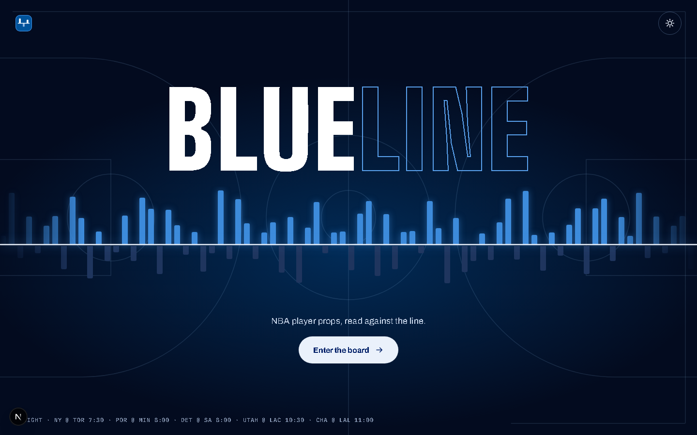
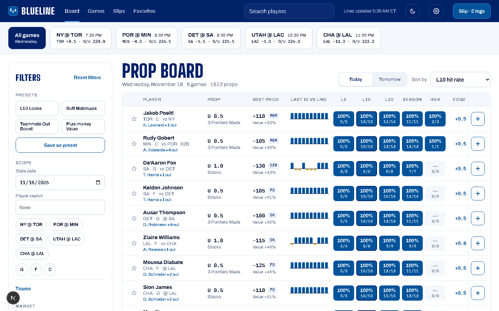
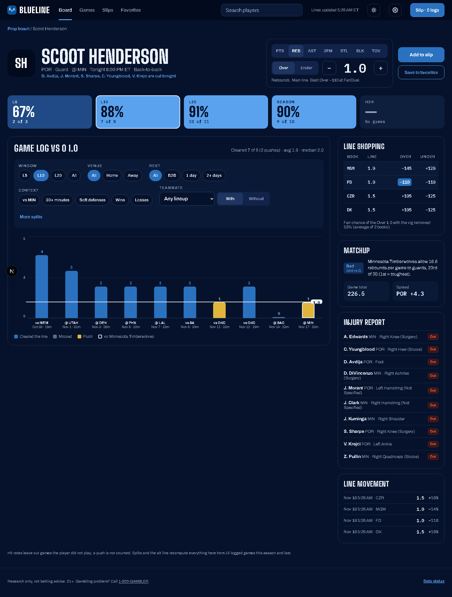
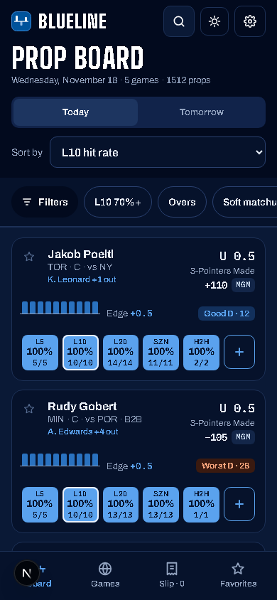
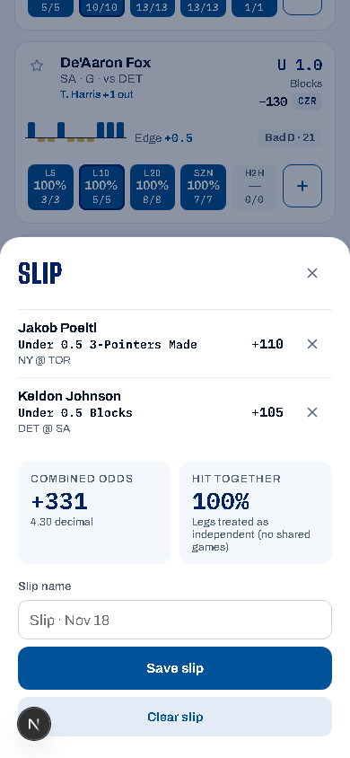

# BlueLine v1: build report

BlueLine is a personal NBA player-props research app with Props Madness–style features, a Duke-blue look, and light/dark themes. It runs as an installable web app (PWA).

The whole build is on branch `build/v1`: 56 commits since the plan commit `2d7b9fc`. Everything is local; nothing has been pushed anywhere.

## Status

- **Built:** all 15 plan tasks, plus one final fix round.
- **Reviewed:** every task passed an independent review. The whole branch then had a full code review and a security review, and all their Critical and Important findings were fixed and re-verified.
- **Final verification on `build/v1`:**

| Check                      | Result                                                                                                                                                                                                       |
| -------------------------- | ------------------------------------------------------------------------------------------------------------------------------------------------------------------------------------------------------------ |
| Lint                       | Pass, 7/7 packages                                                                                                                                                                                           |
| Typecheck                  | Pass, 7/7 packages                                                                                                                                                                                           |
| Unit and integration tests | 656/656 pass, 51 files                                                                                                                                                                                       |
| Production web build       | Pass; every page renders per request, so CSP nonces apply                                                                                                                                                    |
| Playwright end-to-end      | 20/20 pass: intro, board filters + URL, detail splits, slip save, theme persistence, CSP nonce checks against a production server, and axe accessibility (board, detail and welcome × light/dark × 1440/390) |
| Prettier                   | Clean                                                                                                                                                                                                        |

## Screenshots

|                     |                                                    |
| ------------------- | -------------------------------------------------- |
| Intro (dark)        |         |
| Prop board (light)  |       |
| Prop detail (dark)  |          |
| Phone board (dark)  |            |
| Slip drawer (phone) |  |

The design source is the canvas https://claude.ai/artifact/HRc8K2mKCWPJaN9F28AAJT.

## Run it locally (no accounts or API keys needed)

```bash
corepack pnpm install
# fills .data/pglite with recorded ESPN data + sample odds
DATABASE_URL=pglite:.data/pglite corepack pnpm worker seed
# http://localhost:3000, signed in as a dev user
AUTH_DEV_BYPASS=1 corepack pnpm dev
```

Useful commands:

| Command                      | What it does                |
| ---------------------------- | --------------------------- |
| `corepack pnpm test:unit`    | Unit and integration tests  |
| `corepack pnpm e2e`          | Playwright end-to-end tests |
| `corepack pnpm worker <job>` | Runs one worker job         |

Worker jobs: `ingest:schedule`, `ingest:boxscores`, `ingest:injuries`, `ingest:odds [--closing]`, `precompute [--incremental]`, `dvp`, `grade-slips`, `seed`.

## Go live

The "First deploy" checklist in `docs/RUNBOOK.md` has the full steps. In short:

1. **Database.** Create a Neon Postgres database. Run migrations as the owner (`migrate.yml` or the `db:migrate` script), then apply `packages/db/sql/roles.sql`, then create login users for `web_role` and `worker_role`.
2. **Sign-in.** Create Google and GitHub OAuth apps. Set `AUTH_SECRET`, `ALLOWED_EMAILS` (your email), and the provider IDs and secrets.
3. **Odds key.** Get a free SportsGameOdds API key.
4. **GitHub.** Push the repo to a private GitHub repo and add these secrets:

| Secret                | Value                                                   |
| --------------------- | ------------------------------------------------------- |
| `DATABASE_URL`        | Worker role connection string                           |
| `DATABASE_URL_OWNER`  | Owner connection string (used for migrations)           |
| `DATABASE_URL_DIRECT` | Direct (non-pooled) connection string, used for backups |
| `ODDS_PROVIDER`       | `sgo`                                                   |
| `SGO_API_KEY`         | Your key                                                |
| `ODDS_MONTHLY_BUDGET` | `2500`                                                  |
| `BACKUP_PASSPHRASE`   | A passphrase of your choice                             |

5. **Vercel.** Deploy `apps/web` (Root Directory = `apps/web`).
6. **First data.** Run the `daily`, `schedule` and `odds` ingest workflows by hand, then check `/status`.

## What was built

| Area      | Where                              | Highlights                                                                                                                                                                                                                                                                   |
| --------- | ---------------------------------- | ---------------------------------------------------------------------------------------------------------------------------------------------------------------------------------------------------------------------------------------------------------------------------- |
| Contracts | `packages/contracts`               | Zod schemas shared by the UI, API and SQL. Board filters round-trip through the URL. Presets: L10 Locks, Soft Matchups, Teammate Out, Plus-money Value.                                                                                                                      |
| Database  | `packages/db`                      | Drizzle schema with Postgres in production and PGlite locally and in tests. Board and detail queries. Least-privilege roles.                                                                                                                                                 |
| Analytics | `packages/analytics`               | Hit rates (DNPs excluded, pushes tracked), windows, edge, streak, no-vig odds, DvP tiers, rest, teammate splits, parlay and joint hit rate, leg grading. 100% test coverage.                                                                                                 |
| Data      | `packages/adapters`, `apps/worker` | ESPN stats; SportsGameOdds and The Odds API odds. Raw payloads are stored before parsing, odds are append-only, and a monthly budget guard limits API spend. Precompute fills `prop_metrics` and `team_dvp`. Saved slips are graded automatically.                           |
| UI        | `packages/ui`, `apps/web`          | Duke-blue tokens in light and dark, an animated intro, the board with a filter rail or phone filter sheet, the prop detail page with live splits and alt lines, line shopping, slips, favorites, settings, status, and the offline PWA.                                      |
| Security  | `apps/web`                         | Auth.js sign-in (Google/GitHub, verified emails only) limited to an email allowlist. The proxy gates every page and API. Strict CSP with per-request nonces, plus security headers. Per-user rate limiting. IDOR-safe queries. The open redirect is closed and probe-tested. |
| DevOps    | `.github/workflows`                | CI (lint, types, tests, build, e2e, Prettier, gitleaks, audit). Scheduled ingest. Migrations on push to main. Encrypted weekly backups. Dependabot.                                                                                                                          |

## Known risks and open items

- **The live odds adapters have never seen a real API response.** No API keys were available, so the SportsGameOdds and The Odds API parsers are built from their documentation. Check `/status` and the worker logs after the first real `ingest:odds`.
- **Sample-data quirk.** With the seeded sample odds, sorting by L10 hit rate floats near-certain "Under 0.5 blocks/threes" props to the top. This comes from the hand-built sample odds, not the code. Real odds will look different.
- **GitHub Actions minutes are estimated, not measured.** The ingest schedule is about 33 runs a day. A private repo gets 2,000 free minutes a month, which may be tight. The RUNBOOK explains how to measure one run.
- **Two setup steps stay manual.** `roles.sql` and the login roles are applied by hand; the migrations workflow does not run them.
- **Deferred minor items.** They are listed in `docs/build-ledger.md` and triaged by the final review as fine to defer. Examples:
  - An empty injury report leaves the previous report active.
  - Some helper code is duplicated across packages.
  - The slip fallback label still says "no shared games" when 1–4 shared games exist.
  - The web role keeps an unused read grant on `provider_aliases`.
- **Not done in v1, by design:** other sports, ML projections, payments, push alerts, and native apps.

## Rulings I made on your behalf

Each ruling records what I decided and what it costs if the decision was wrong.

| #       | Decision                                                                                                                                                                                           | Cost if wrong                           |
| ------- | -------------------------------------------------------------------------------------------------------------------------------------------------------------------------------------------------- | --------------------------------------- |
| R1      | One "foundation" agent built Tasks 1–3 instead of me.                                                                                                                                              | One extra review cycle                  |
| R2      | API routes get the user through one `getUserId()` helper; Task 13 swapped in Auth.js behind it.                                                                                                    | Route changes                           |
| R3      | The filters task owns the filter components; the pages only lay them out.                                                                                                                          | Duplicated UI                           |
| R4      | Coverage, React plugin and jsdom were added to the dependency install.                                                                                                                             | None                                    |
| R5      | Agents ran in parallel in separate git worktrees, as you asked.                                                                                                                                    | Merge conflicts, which I resolved       |
| R6      | Accepted tooling dependencies: vite, pnpm, React DOM types, and TypeScript pinned to 6.0.3.                                                                                                        | None functional                         |
| R7      | Database operators are imported through `@blueline/db` only.                                                                                                                                       | Import churn                            |
| R8      | The Plus-money preset is "odds ≥ +100 and value ≥ 5%", as the spec says; the plan was wrong.                                                                                                       | Fewer rows                              |
| R9      | The spread filter is a maximum absolute spread (blowout risk).                                                                                                                                     | Add a range later                       |
| R10     | Filter percentages are 0–100 and stored rates are 0–1, converted in one helper.                                                                                                                    | ×100 bug (covered by tests)             |
| R11     | Unknown or invalid URL filters fall back to the defaults and never cause a server error.                                                                                                           | None                                    |
| R12     | I created the worktrees myself, because the built-in isolation tripped on drive-letter case.                                                                                                       | None                                    |
| R13     | The no-vig over probability for −120/+100 is 0.5217; the plan's 0.5238 was an arithmetic error.                                                                                                    | None                                    |
| R14     | Accepted the analytics agent's small choices (head-to-head covers two seasons, tie-breaks, unrounded parlay odds).                                                                                 | Display nuances                         |
| R15–R16 | Scheduled jobs queue per job type, keyed on the job name.                                                                                                                                          | Brief write overlap                     |
| R17–R18 | Theme is applied before paint (no flash). The intro owns its own `<main>`.                                                                                                                         | Theme flash                             |
| R19     | Chart misses use the higher-contrast slate color instead of the mockup's lighter grey.                                                                                                             | Darker miss bars                        |
| R20     | The database package exposes `./queries/*` subpaths.                                                                                                                                               | None                                    |
| R21     | Accepted the backend agent's API extras; rate limiting stayed with the security task.                                                                                                              | API reshaping                           |
| R22     | A books filter recomputes best price only; value stays the all-book consensus.                                                                                                                     | Value slightly off under a books filter |
| R23     | Filter components sit inside Suspense; the filter sheet's focus handling is verified by the end-to-end tests.                                                                                      | None                                    |
| R24     | The preset id is validated with a regex rather than Zod.                                                                                                                                           | None                                    |
| R25     | The current injury report is the newest whole batch.                                                                                                                                               | Recovered players shown as Out          |
| R26     | Relative local database paths resolve against the repo root for both web and worker.                                                                                                               | Web opens an empty database             |
| R27     | The live odds adapters are flagged as unverified (see risks above).                                                                                                                                | Parsing fixes needed at go-live         |
| R28     | Closing line = newest closing row. Line move = current line − first captured line.                                                                                                                 | Movement display                        |
| R29     | "44px targets" means the tap area, which may be bigger than the visible chip.                                                                                                                      | Denser touch UI                         |
| R30     | "Key teammate out" = Out/Doubtful and averaging ≥ 20 minutes. DvP allowed-per-game is stored raw. Spread is the home team's.                                                                       | Preset sensitivity                      |
| R31     | The board defaults to today's Eastern date, with a Today/Tomorrow switch.                                                                                                                          | None                                    |
| R32     | The quick intraday refresh always rebuilds DvP (about 1 extra second).                                                                                                                             | About 1 s per run                       |
| R33–R36 | The CSP nonce passes from the proxy to the layout through `x-nonce`. Public paths are listed in one place. Sign-out clears the service-worker caches. Next 16 `proxy.ts` replaces `middleware.ts`. | Blocked scripts in production (tested)  |
| R37     | HSTS is set without `preload`, which is hard to undo.                                                                                                                                              | Can add it later                        |
| R38     | The integration fixes were folded into the end-to-end task.                                                                                                                                        | Larger diff                             |
| R39     | The Playwright per-test timeout is 120 s, because cold dev-server compiles are slow.                                                                                                               | Slower failure detection                |
| R40     | Rejected a reviewer finding as false; all 7 test configs do set 30 s timeouts.                                                                                                                     | None                                    |
| R41     | One final fix round covered the whole-branch and security review findings, with one dependency removal allowed.                                                                                    | Larger final diff                       |

## Interruptions during the build

- **Usage limit, three times.** Agents hit the account's 5-hour limit three times and were resumed from their saved progress each time.
- **One session exit.** One Claude Code process exited mid-task; that agent was also resumed with no work lost.
- **No shutdown.** The PC was never shut down. The usage limit was never reached in this session after the shutdown rule was set.
